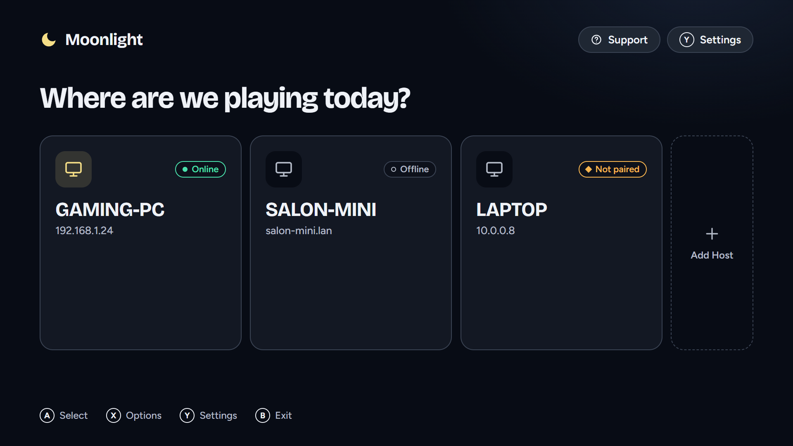
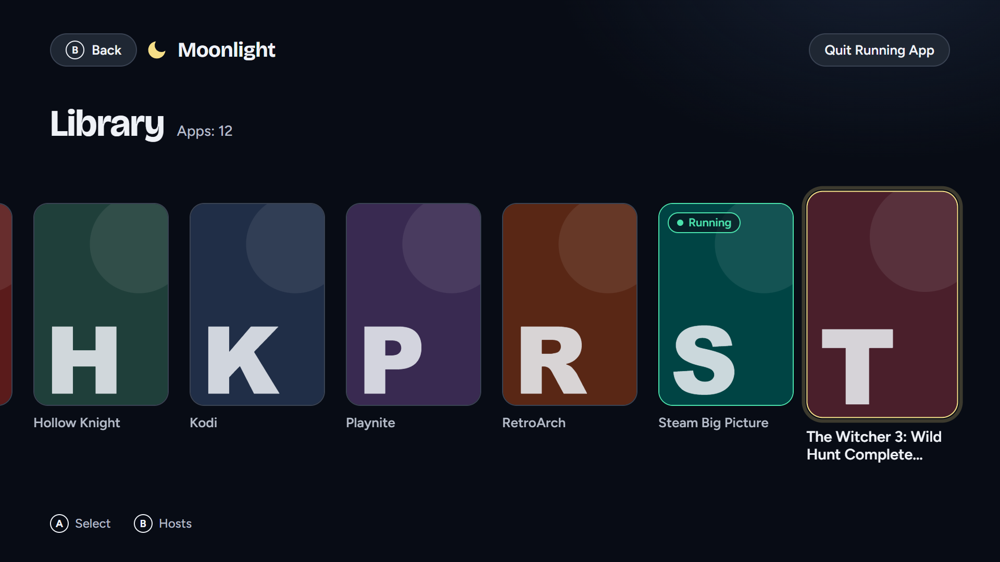
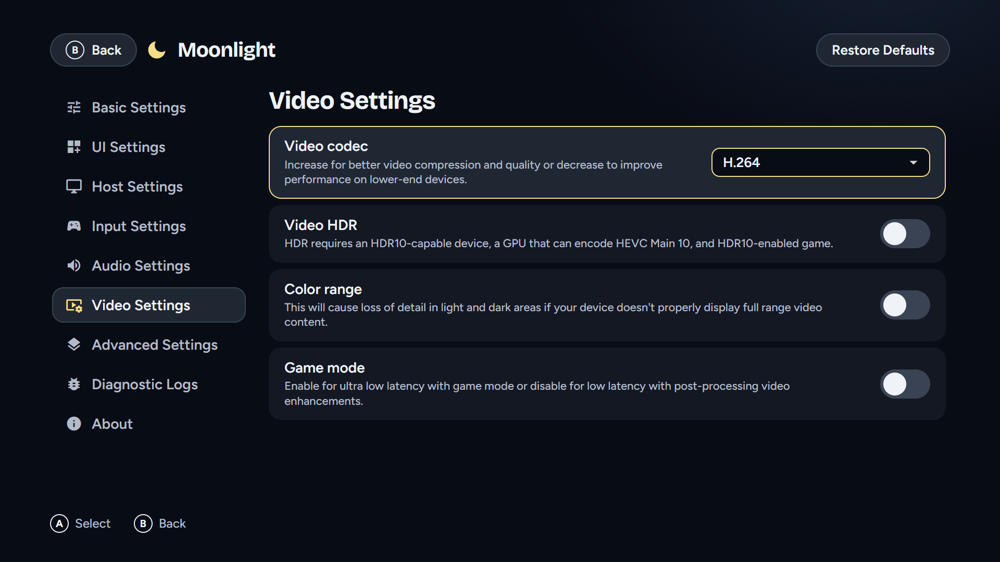
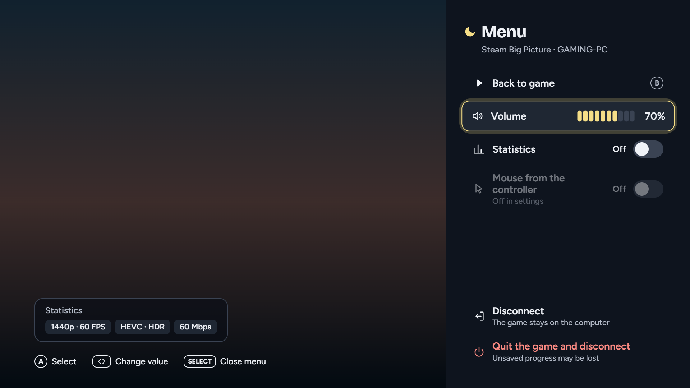

# Moonlight Tizen Modern

Moonlight Tizen Modern is a fork of [brightcraft/moonlight-tizen](https://github.com/brightcraft/moonlight-tizen), a port of [Moonlight ChromeOS](https://github.com/moonlight-stream/moonlight-chrome), which is an open-source client for NVIDIA GameStream and [Sunshine](https://app.lizardbyte.dev/Sunshine/).

This application allows you to stream your collection of games, programs, or your full desktop from your powerful PC to your Samsung Smart TV.

This fork has a new interface, a menu that opens during a stream, and a long list of changes to the stream itself and to the way the application recovers from errors. They are listed [below](#-about-this-repository).

---

## 🎨 Modern UI

The whole interface was redesigned for the TV and is driven by the remote or a gamepad. It has its own set of components, moves with transitions that the compositor of the TV does, and keeps the focus visible from across the room.

<p align="center">
  
  
</p>
<p align="center">
  
  
</p>

*The screenshots were taken from the real interface with sample data.*

---

## ⚙️ Prerequisites

Before proceeding with the installation, please take a moment to ensure that your current hardware, network, and input setup fully meet the necessary requirements described below:
- **Client:** Samsung Smart TV running **Tizen 9.0 or newer**. The interface was designed for the browser of Tizen 9 and is not tested on older versions.
- **Host:** Gaming PC with a GPU capable of hardware encoding that meets the [system requirements](https://docs.lizardbyte.dev/projects/sunshine/latest/index.html#%EF%B8%8F-system-requirements) of Sunshine. The application is developed and tested with Apollo and Vibepollo, which are forks of Sunshine.
- **Network:** Mid-range or high-end wireless router with a stable wireless connection (Wi-Fi 5/6) for the TV and a wired gigabit Ethernet connection (CAT5e or better) for the host PC are strongly recommended.
- **Input:** [Supported gamepad](https://github.com/brightcraft/moonlight-tizen/wiki/Frequently-Asked-Questions#which-gamepad-controllers-are-officially-supported-on-samsung-tvs) connected to your TV or directly connected to a nearby PC is highly recommended for the best streaming experience.

---

## 📦 Installation

The recommended way to install Moonlight is [Apps2Samsung](https://github.com/Apps2Samsung/Apps2Samsung), a free tool for Windows, macOS, Linux and Android that sideloads a `.wgt` package onto a Samsung TV. It finds the TV, takes care of the certificates and installs the application, so you do not need Tizen Studio.

1. [Enable Developer Mode](https://github.com/Apps2Samsung/Apps2Samsung#readme) on the TV: open **Apps**, press `1 2 3 4 5` on the remote, switch **Developer mode** on, enter the IP address of your computer and restart the TV.
2. Download `Moonlight.wgt` from the [Releases](https://github.com/mmadej20/moonlight-tizen-modern/releases) page.
3. Start Apps2Samsung on the computer, select your TV, choose a custom `.wgt` file and install `Moonlight.wgt`.
4. Launch **Moonlight** on the TV and add your host.

Other ways to install a `.wgt` (Tizen Studio, the command line) work as well and are described in the [Installation Guide of the upstream project](https://github.com/brightcraft/moonlight-tizen/wiki/Installation-Guide).

To build the package yourself, see [Contributing](#%EF%B8%8F-contributing).

---

## 📚 Documentation

This fork does not have a wiki of its own. The guides of the upstream project explain how the application works, and most of what they say applies here too, but **not everything there is up to date with this version** (the interface, the menu of a stream and some settings are different). Please read them with that in mind:
- 🧭 [Quick Start Guide](https://github.com/brightcraft/moonlight-tizen/wiki/Quick-Start-Guide)
- 🚀 [Installation Guide](https://github.com/brightcraft/moonlight-tizen/wiki/Installation-Guide)
- ✨ [Features Overview](https://github.com/brightcraft/moonlight-tizen/wiki/Features-Overview)
- ❓ [Frequently Asked Questions](https://github.com/brightcraft/moonlight-tizen/wiki/Frequently-Asked-Questions)
- ⚠️ [Known Issues & Limitations](https://github.com/brightcraft/moonlight-tizen/wiki/Known-Issues-&-Limitations)
- 🔧 [Troubleshooting Guide](https://github.com/brightcraft/moonlight-tizen/wiki/Troubleshooting-Guide)
- 🔮 [Development Guide](https://github.com/brightcraft/moonlight-tizen/wiki/Development-Guide)

---

## 📖 About This Repository

This project originally started as a **WASM port** for Tizen TV created by the [Samsung Developers Forum](https://github.com/SamsungDForum/moonlight-chrome). They demonstrated how Moonlight could run on Tizen OS by converting the original Native Client module to WebAssembly, reimplementing the video and audio pipelines using the Tizen WASM Player to leverage hardware acceleration, and adapting the application to the Tizen web environment (see their [full article](https://developer.samsung.com/smarttv/develop/extension-libraries/webassembly/game-streaming-on-tizen-tv-with-wasm.html) for technical details). [KyroFrCode](https://github.com/KyroFrCode/moonlight-chrome-tizen) turned it into a fully installable application, and [BrightCraft](https://github.com/brightcraft) continued it for more than two years in [brightcraft/moonlight-tizen](https://github.com/brightcraft/moonlight-tizen), the project that this fork is based on.

**This repository is a fork of [brightcraft/moonlight-tizen](https://github.com/brightcraft/moonlight-tizen).** It keeps the full history of the upstream project and follows its releases by merging them (the last release merged is v1.18.0). What follows is everything that this fork does differently, taken from its commits.

### New interface and menus

- **A new interface, written from scratch** with its own components (`wasm/static/css/ui.css`) in place of the old stylesheet: the hosts screen, the library of apps as one row of tiles that glides under the focus, the settings, the dialogs and the loading screen. Box art is shown from a lighter copy of 360 px, so the library stays smooth. The selected number of an IP address is clearly marked.
- **A new application icon:** the moon of the new interface with the name under it.
- **A menu during a stream.** Hold **Select** on a gamepad for one second, or press the **green** or **Info** key of the remote. It has: back to the game, volume, statistics, mouse from the controller, disconnect (the game keeps running on the computer), and quit the game and disconnect. While it is open the game gets no input from the pad, and nothing leaks into it when the menu closes.
- **The volume bar of Moonlight during a stream** instead of the bar of the TV. The bar of the system drawn over the picture caused small stutters. It can be turned off in the audio settings.
- **Diagnostic Logs:** the application keeps a log of the current and of the previous session on the TV, and can send it to your computer with `tools/Receive-MoonlightLogs.ps1`. The address of the computer and the port are set with the keys of the remote, so no keyboard is needed. Turning the logs off deletes them.
- **Polish translation**, next to English and Brazilian Portuguese.

### The stream

- **Frame pacing that follows the stream.** Upstream anchors the time of every frame to the first one, so a late first frame becomes the delay of the whole stream. Here the anchor follows the frames of the last two seconds and the wait is capped. On the TV where it was measured the average packet queue delay fell from about 136 ms to under 1 ms. The spin window of the pacer adapts, and a pacing reset keeps the timestamps of the video.
- **Audio synchronization** pulls back audio that runs ahead of the video with an occasional single dropped packet, and drops more only past a hard limit. EMSS is the default audio backend, and Web Audio is optional.
- **Controllers cost less.** The input thread reads all gamepads with one call, polls slowly while no gamepad is used, and sends the state to the host only when it changes. Rumble is deduplicated and applied at most every 50 ms.
- **An experimental setting for RFI recovery** (reference frame invalidation, per codec), off by default.
- **Game Mode is never forced** and is off by default.
- **The module is built with `-O2`** instead of `-Os`.

### Reliability

- **A freeze caused by memory corruption is fixed.** Reading a `std::string` that C++ returns to JavaScript through Embind wrote a byte past its buffer and could freeze the stream after a while. The fix was also sent to upstream and was accepted there ([pull request #185](https://github.com/brightcraft/moonlight-tizen/pull/185)).
- **Stopping a stream is one owned sequence.** Teardown cannot race with the start of the next stream, and a failed start gives its slot back. Waits for the media pipeline are bounded (10 s), can be cancelled, and report an error that says what failed.
- **HTTP requests have an id and a deadline,** and can be cancelled. Downloads of box art are limited to two at a time so they cannot delay the start of a stream. The server info is refreshed once per list of apps. Pairing parsing is hardened, and there is no time limit for entering the PIN.
- **Start-up is lighter.** The scan of the local network runs only when no known host answers.
- **A log that fills up cannot stall the application:** repeated lines are collapsed, and the log file is cut down in one step.

### Engineering

- **Automated tests:** about 70 suites for the JavaScript side (`npm run test:js`) and for the C and C++ code that compiles on a computer (`tools/run-native-tests.sh`). Upstream has none.
- **A pinned build profile:** jQuery 2.2.0 and the Emscripten 1.39.4.7 toolchain of Samsung, both fixed by the build.

---

## 🛠️ Contributing

Contributions are welcome! You can help by forking the repo, creating pull requests, opening issues, or simply giving a ⭐ to the project.

Where to start:
- 🐛 Report a bug or request a feature: [Issues](https://github.com/mmadej20/moonlight-tizen-modern/issues). For a bug in a stream, attach the log (**Settings → Diagnostic Logs**, and mask your private addresses).
- 🧪 Test a build on your TV and tell what you see, especially on a TV that is not the one this fork was made on.
- 🔁 A fix that is not specific to this fork is better sent to [upstream](https://github.com/brightcraft/moonlight-tizen) as well.

**Building.** The WASM module compiles only inside Docker:

```sh
docker build --progress=plain -t moonlight-tizen-modern .
docker create --name moonlight-build moonlight-tizen-modern artifact-only
docker cp moonlight-build:/home/moonlight/Moonlight.wgt .
docker rm moonlight-build
```

**Tests** must stay green before a pull request:

```sh
npm install
npm run test:js              # the JavaScript suites
tools/run-native-tests.sh    # the C and C++ suites that compile on a computer (Linux or WSL)
```

Files are checked out with CRLF on Windows, so tests must accept both `\n` and `\r\n`.

See the [CONTRIBUTING](.github/CONTRIBUTING.md) file for the general guidelines and for how to add a language.

---

## ⚖️ License

This project is licensed under the `GNU General Public License v3.0`. See the [LICENSE](LICENSE) file for more information.

---

## 🙏 Contributors

The people below contributed to the **upstream project**, [brightcraft/moonlight-tizen](https://github.com/brightcraft/moonlight-tizen), and this fork stands on their work. Thank you for every fix, feature and report that you gave to this project.

<a href="https://github.com/brightcraft/moonlight-tizen/graphs/contributors?all=1">
  
</a>

### Special thanks to:

- [BrightCraft](https://github.com/brightcraft) — for the upstream project, [brightcraft/moonlight-tizen](https://github.com/brightcraft/moonlight-tizen), which this fork is based on, and for more than two years of work on it.
- [Moonlight Game Streaming Project](https://github.com/moonlight-stream) — for creating the core Moonlight implementation, adapting the NVIDIA GameStream protocol, and developing the Moonlight Chrome OS client. The project’s open-source work made it possible to bring Moonlight streaming support to additional platforms and serves as the foundation for the entire Tizen port.
- [Samsung Developers Forum](https://github.com/SamsungDForum/moonlight-chrome) — for creating the first Tizen OS (WASM) adaptation based on the Moonlight Chrome OS client. Their work made Moonlight available on Samsung Smart TVs by integrating the client with Tizen’s WASM environment, including video and audio playback through Tizen WASM Player, platform-specific adjustments, and the initial groundwork required for running Moonlight on Tizen devices.
- [KyroFrCode](https://github.com/KyroFrCode/moonlight-chrome-tizen) — for further developing the Tizen implementation by introducing improvements such as a dedicated application build method, 1440p resolution support, a shortcut combo to stop the streaming session, and audio volume control using the remote.
- [OneLiberty](https://github.com/OneLiberty/moonlight-chrome-tizen) — for expanding the Tizen implementation in their fork with features such as video codec selection, mouse emulation using the gamepad, Wake-on-LAN (WoL), a new IP address input mode, and other improvements.
- [toypoodlegaming](https://github.com/toypoodlegaming/moonlight-chrome-tizen) — for further expanding the functionality in their fork with features such as 5.1 and 7.1 surround sound configuration, performance statistics, and enhanced bitrate calculation.
- [eduardomozart](https://github.com/eduardomozart) — for contributing to the project with localization support featuring Tizen-first locale detection, HTTP subnet scanning, IPv6 and DNS hostname support, custom port support, Smart Hub Preview support, and build optimizations, along with numerous fixes and improvements.
- [fophillips](https://github.com/fophillips) — for contributing to the project by integrating the Web Audio backend implementation from [ruanformigoni](https://github.com/ruanformigoni) alongside the existing EMSS backend, with an Audio Backend selection setting for switching between the two renderers.
- [Apps2Samsung](https://github.com/Apps2Samsung/Apps2Samsung) — for the tool that makes installing the application on a Samsung TV simple.
